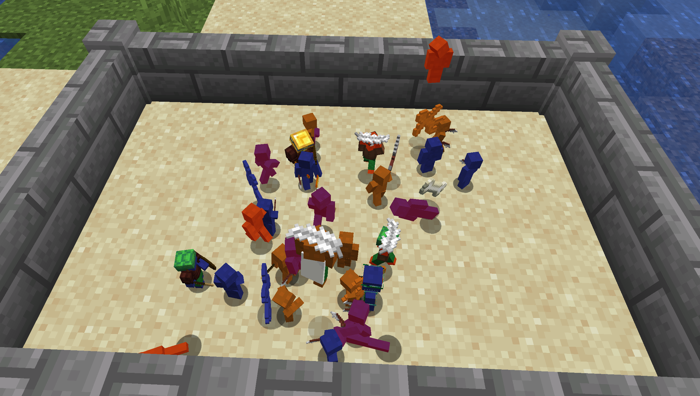
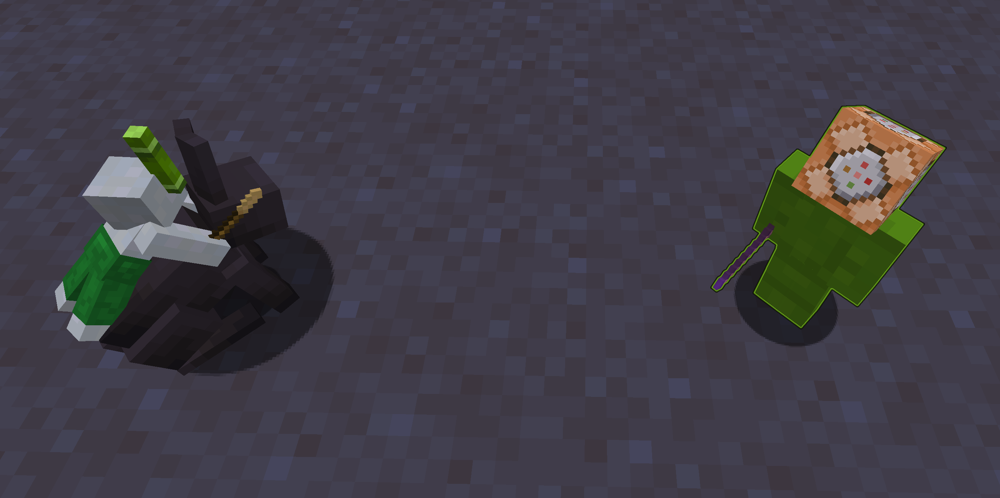
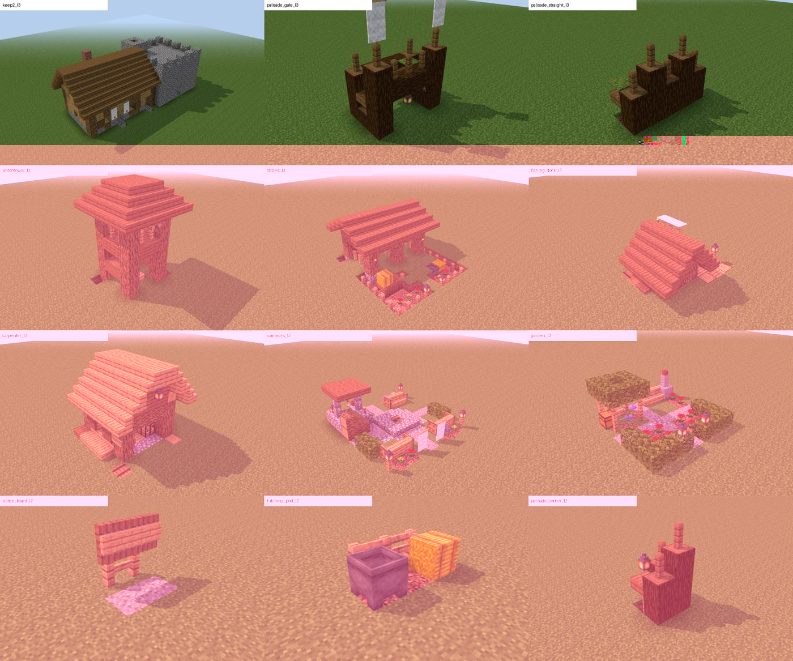
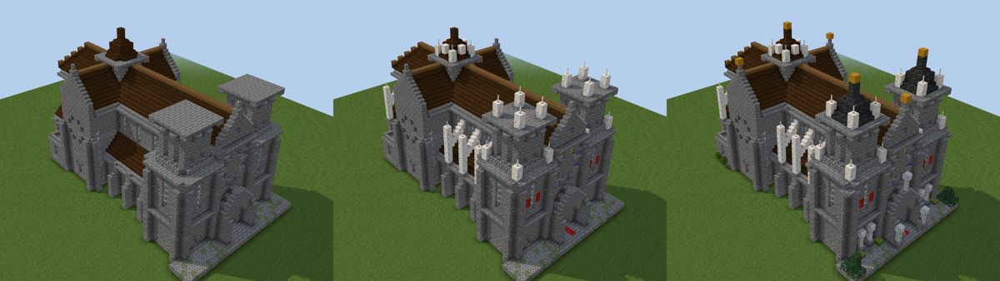

<div align="center">

# Clay Soldiers Kingdoms

**Tiny clay armies that build, farm and fight. Soon, whole kingdoms.**

A data-driven Minecraft mod for **1.21.1 / NeoForge**, forked from
[Clay Soldiers Remake](https://github.com/Bumble-B33/csr) by Bumble B33.


<sub>Structures rendered in the Structure Studio with real Minecraft block models.</sub>

</div>

## What is it?

Clay Soldiers Remake brings the classic Clay Soldiers mod to modern Minecraft: you shape little clay
warriors, dress them with gear, and watch them skirmish. **Clay Soldiers Kingdoms** is our fork that
aims further: soldiers that **build real buildings on their own**, gather resources, and one day
found **kingdoms** that grow, defend themselves and go to war with each other.



<!-- TODO(Carlton): add in-game screenshots here, e.g. soldiers building a keep, scaffolding, a kingdom book.
     Save them small (under ~300 KB, JPEG) in docs/img/ and link them like the Studio ones below. -->


| Library | Market | Town hall |
|---|---|---|
|  |  |  |

## What works today

- **Customizable clay soldiers** with teams, gear and effects, all driven by datapacks (inherited from CSR).
  [Wiki](https://bumble-b33.github.io/csr-wiki/)
  
- **Builders that work from blueprints.** Put a blueprint on an easel, stock a chest, and soldiers
  fetch the blocks, walk to the right spot and place them one by one.
  They open and close wooden doors, reach up to 8 blocks high, and never place a block twice.
- **Scaffolding for tall builds.** When a block is out of reach, builders put up scaffolding columns,
  climb them, and take them down again when the structure is finished.
- **A library of 70+ kingdom structures**: keep, houses, farms, smithy, library, market, chapel,
  watchtowers, stone walls, mines and more, many with several upgrade levels that each add something new.
  Builders can build every one of them from scratch (an automated test checks it).
- **Kingdoms, first steps.** Sneak + right-click your king (a clay soldier wearing a gold ingot)
  with a gold block to found a kingdom. It has a claim, a stockpile, a population count and a chronicle,
  all readable in an in-game observer book. If the king dies, the kingdom falls to ruin.
- **Terrain awareness.** Before founding, the mod scores the ground for a keep (cliffs, lava, water,
  slope) and suggests the best nearby spot.
- **A serious test suite.** 160+ automated GameTests run on every push.

## Where it is going

The [roadmap](docs/ROADMAP.md) leads from today to autonomous kingdoms: soldiers who build their
own keep (next), an economy loop, villages and walls that grow with layout rules, mining, events and
defense, rival kingdoms and war, and finally decay and ruins. Design notes live in [`docs/`](docs/).

## Structure Studio

Structures are designed and reviewed outside the game in the **Structure Studio** (`studio/`), a local
browser tool that shows every structure in 3D with real Minecraft block models, level by level.
You approve or reject versions with notes, compare them side by side and roll back; approved
structures are promoted into the mod.





```bash
cd studio
npm install
npm run dev        # http://127.0.0.1:5174
```

The Studio needs Minecraft's own textures, which are not in this repo. Copy your own
`1.21.1.jar` into `studio/minecraft/` (git-ignored). See [`studio/README.md`](studio/README.md).

## Build and play

Requires Java 21. From the project root:

```bash
./gradlew :neoforge:runData      # generate recipes, models, lang (needed once, and after datagen changes)
./gradlew :neoforge:runClient    # start Minecraft with the mod
./gradlew :neoforge:build        # build the jar into neoforge/build/libs/
./gradlew :neoforge:runGameTestServer   # run the automated tests
```

In a dev world, `/csr dev book` gives a toolkit book with buttons for test scenarios, and
`/csr build <blueprint>` places an easel with a blueprint. Details: [`CLAUDE.md`](CLAUDE.md).
Only NeoForge is supported for now; the Fabric module is kept but not maintained.

## Credits and license

Created by **Bumble B33** ([original repository](https://github.com/Bumble-B33/csr)).
The kingdoms work is built on top of it. MIT licensed, see [`LICENSE`](LICENSE).
Minecraft is a trademark of Mojang; this project is not affiliated with Mojang or Microsoft.
