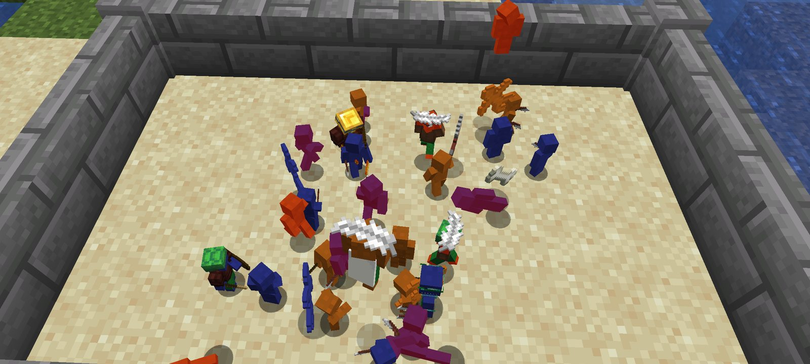
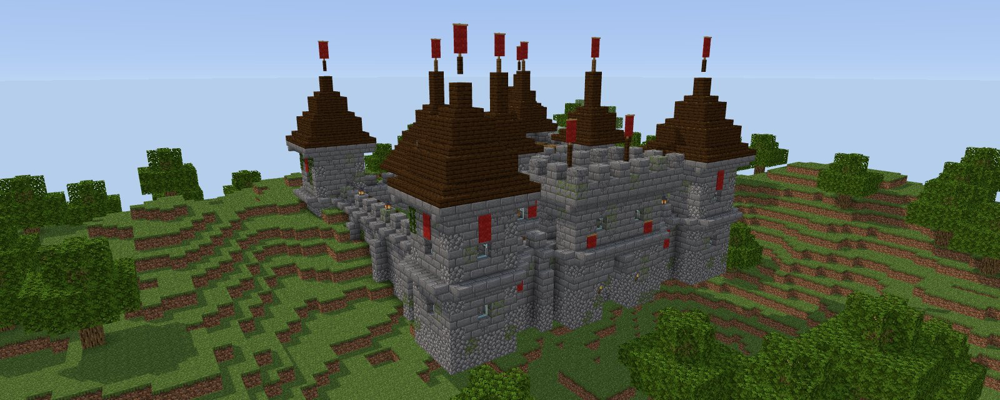
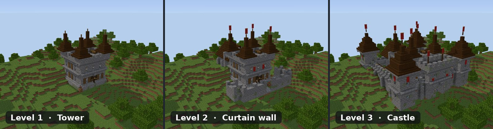
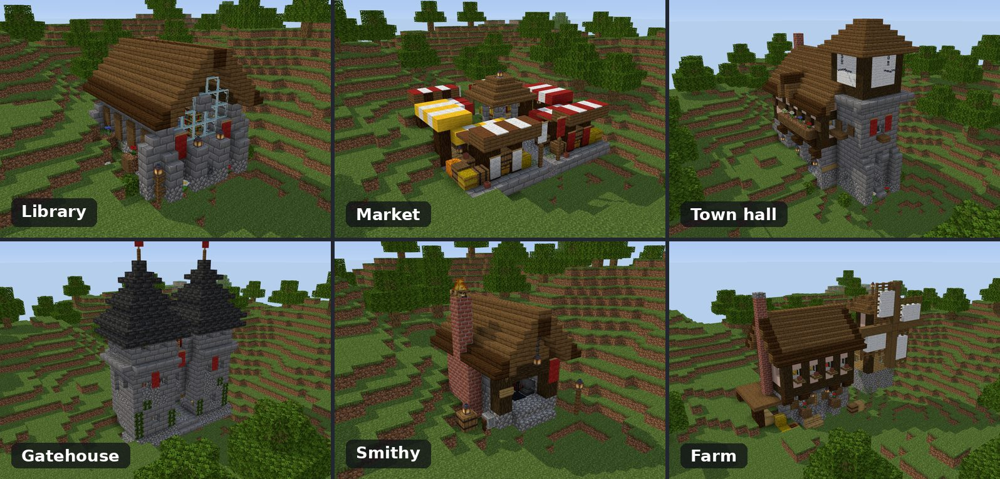
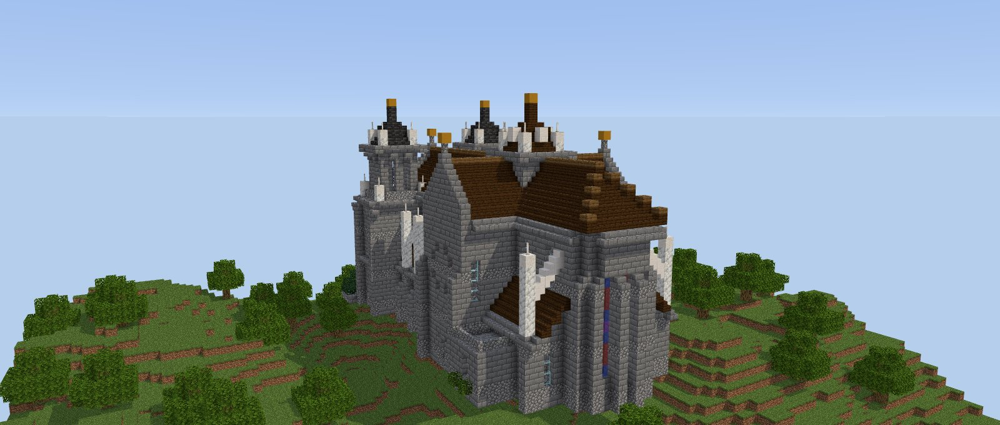

<div align="center">

# Clay Soldiers Kingdoms

### Tiny clay armies that build their own kingdoms.

[](https://www.minecraft.net/)
[](https://neoforged.net/)
[](https://adoptium.net/)
[](LICENSE)

</div>

<p align="center">
  
</p>

<p align="center">
  <a href="#what-it-is">What it is</a> ·
  <a href="#what-works-today">What works today</a> ·
  <a href="#the-buildings">The buildings</a> ·
  <a href="#where-its-going">Where it's going</a> ·
  <a href="#build-and-play">Build and play</a>
</p>

## What it is

Shape a lump of clay into a soldier, hand it a stick, and watch it fight. That is
[Clay Soldiers Remake](https://github.com/Bumble-B33/csr) by Bumble B33, the classic mod brought to modern Minecraft.

**Clay Soldiers Kingdoms** takes it further. Give a team of soldiers a blueprint and a chest of
blocks and they build the structure themselves, block by block, putting up scaffolding when the walls get tall.
Crown a king and the team founds a kingdom with a claim, a stockpile and a chronicle. The goal is
kingdoms that grow on their own: farms, villages, walls and a castle, and rivals that go to war with each other.

<p align="center">
  
</p>

## What works today

- **Soldiers built from datapacks.** Teams, gear, mounts and effects, all data-driven (from the original mod,
  documented on its [wiki](https://bumble-b33.github.io/csr-wiki/)).
- **Builders.** Put a blueprint on an easel next to a stocked chest. Soldiers fetch each block, walk to its spot
  and place it. They open and close wooden doors on the way and reach up to 8 blocks above their feet.
- **Scaffolding.** When a block is too high to reach, builders raise scaffolding columns, climb them,
  and take them down when the building is finished.
- **Kingdoms, first steps.** Sneak and right-click your king (a soldier wearing a gold ingot) with a gold block.
  The kingdom gets a claim, a stockpile, a population count and a chronicle, all shown in an in-game book.
  If the king dies, the kingdom falls to ruin.
- **Ground sense.** Before founding, the mod checks the site for cliffs, lava, deep water and steep slopes,
  and points to the best spot nearby.
- **Tested.** More than 160 automated GameTests run on every push, and a separate run has builders put up
  every structure, every level, from scratch.

<p align="center">
  
</p>

## The buildings

More than 60 structures, from cottages and farms to a cathedral. Most come in three levels, and every
level adds something you can see. The keep grows from a lone tower into a walled castle:

<p align="center">
  
</p>

A kingdom needs more than walls:

<p align="center">
  
</p>

And the showpiece, the cathedral, 28 blocks tall:

<p align="center">
  
</p>

<sub>All renders come from the Structure Studio with real Minecraft block models.</sub>

### Structure Studio

Every structure is designed and reviewed in the **Structure Studio** ([`studio/`](studio/)), a browser tool that
shows structures in 3D, level by level. Versions are approved or rejected with notes, compared side by side and
rolled back. Only approved versions are promoted into the mod.

```bash
cd studio
npm install
npm run dev        # opens on http://127.0.0.1:5174
```

The Studio needs Minecraft's textures, which are not in this repo: copy your own `1.21.1.jar` into
`studio/minecraft/`. See [`studio/README.md`](studio/README.md).

## Where it's going

| Stage | | Status |
|---|---|---|
| 0–3 | Foundations, kingdom core, terrain, tall builds | ✅ Done |
| 4 | Soldiers build their own keep | 🔨 Next |
| 5–8 | Economy, villages and layout, more building tiers | Planned |
| 9–11 | Mining, daily life, raids and defense | Planned |
| 12–14 | Rival kingdoms and war, decay and ruins | Planned |

The full plan is in [`docs/ROADMAP.md`](docs/ROADMAP.md); design notes live in [`docs/`](docs/).

## Build and play

Requires Java 21. From the project root:

```bash
./gradlew :neoforge:runData            # generate recipes, models and lang (once, and after datagen changes)
./gradlew :neoforge:runClient          # start Minecraft with the mod
./gradlew :neoforge:build              # build the jar into neoforge/build/libs/
./gradlew :neoforge:runGameTestServer  # run the automated tests
```

In a dev world, `/csr dev book` gives a toolkit book with buttons for test scenarios, and
`/csr build <blueprint>` places an easel with a blueprint. Developer notes are in [`CLAUDE.md`](CLAUDE.md).
Only NeoForge is supported for now; the Fabric module is kept but not maintained.

## Credits and license

Clay Soldiers Remake was created by **Bumble B33** ([original repository](https://github.com/Bumble-B33/csr)).
The kingdoms work is built on top of it. MIT licensed, see [`LICENSE`](LICENSE).

Minecraft is a trademark of Mojang. This project is not affiliated with Mojang or Microsoft.
